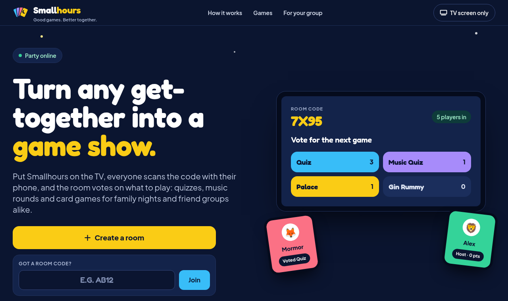

<h1 align="center">
  <picture>
    <source media="(prefers-color-scheme: dark)" srcset="public/images/smallhours-logo.svg">
    
  </picture>
</h1>

<p align="center"><strong>Good games. Better together.</strong></p>

<p align="center">
  Real-time party games for one shared TV and a room full of phones.<br>
  Scan the QR code, pick an avatar, and play — no accounts or phone apps required.
</p>

<p align="center">
  <a href="package.json"></a>
  <a href="https://github.com/small-hours-games/small-hours/actions/workflows/docker.yml"></a>
  
  <a href="android-tv/README.md"></a>
</p>

<p align="center">
  <a href="#quickstart">Quickstart</a> •
  <a href="#games">Games</a> •
  <a href="#features">Features</a> •
  <a href="#android-tv-app">Android TV</a> •
  <a href="#run-it-on-a-server">Docker Hosting</a> •
  <a href="#configuration">Configuration</a> •
  <a href="#contributing">Contributing</a>
</p>

<p align="center">
  
</p>

Smallhours turns any living room into a live game show. One shared display (a TV, monitor, or projector) hosts the board, music, narration, and scores. Up to 20 players join from their phones using a four-character room code or the Night-Navy branded QR code and play straight in the browser.

Host it in seconds on a laptop for game night, or keep it running 24/7 on a home server with Docker.

---

## Quickstart

Requires [Node.js](https://nodejs.org) **22 or later**.

```bash
git clone https://github.com/small-hours-games/small-hours.git
cd small-hours
npm install
npm start
```

Verify the server is healthy:

```bash
curl http://localhost:3000/health
```

Open `http://<your-computer-ip>:3000/tv` (for example `http://192.168.1.50:3000/tv`) on your TV or shared monitor, then scan the QR code on the screen with your phones.

> [!NOTE]
> The TV and phones need to be on the same network (`localhost` on a phone refers to the phone itself). Internet access is needed for fetching fresh trivia, Music Quiz audio clips, Gemini TTS, and CDN fonts/libraries. Set `PORT` in `.env` if you prefer another port.

---

## Games

All eight lobby games below are built in and discovered automatically at startup:

| Game | Players | AI Bots | What you're getting into |
| --- | --- | --- | --- |
| 🎯 **Quiz** | 1–20 | — | Vote on trivia categories, race the timer, and hear narrated questions & reveals. |
| 🎵 **Music Quiz** | 1–20 | — | Listen to track clips on the TV, name the artist or song, and build streaks. |
| 👑 **Palace** | 1–6 | Up to 4 | Classic shed-your-cards table game (`shithead` rules) — solo vs bots or with friends. |
| ♠️ **Gin Rummy** | 1–2 | 1 | Build sets and runs, watch discards, and knock low against Nova-7 or a rival. |
| 7️⃣ **Sjuan** | 1–8 | Up to 4 | Build suits outward from the sevens and be the first player out. |
| 🃏 **Blackjack** | 1–8 | — | Place bets, hit, stand, split, or double down against the dealer to 21. |
| 🤠 **Texas Hold'em** | 1–8 | Up to 5 | No-Limit Hold'em with community cards on the TV and private hole cards on your phone. |
| 🔮 **Tilt-Ball Arena** | 1–8 | Up to 5 | Tilt your phone (gyro or touch stick) to knock opponents off a shrinking 60 FPS TV arena. |

Solo players automatically get AI seats from the robot cast (**Nova-7**, **Glitch**, **Prof. Byte**, **Turbo**, and **Echo**), complete with animated TV vector rigs and in-game quips. Bots fill empty seats cleanly and never earn session points.

Experimental / hidden games included in `games/` (`Högt/Lågt`, `Uno`, and the `Sensor Lab` telemetry tool) stay out of the public lobby unless toggled in `/admin`.

---

## Features

- **Branded Night-Navy QR Join:** Scannable Level-H SVG QR code on the TV lobby with the Smallhours four-card Moon emblem, rounded modules, and one-tap room codes — zero phone app install needed.
- **Touch-First Phone Controls:** Card games use a shared card-table kit with press-and-slide thumb lift, swipe-up or drag-to-play gestures, and a four-colour suit toggle; Tilt-Ball Arena supports live phone motion steering; installable as a fullscreen PWA.
- **Talking Game-Show Host:** Quiz questions and reveals are narrated aloud on the TV using Gemini TTS (when configured) or the browser's built-in speech synthesis.
- **Beat-Synced Lobby Show:** Music in `music/lobby/` pairs with beat maps (`public/shows/`) to animate the top bar — complete with an upgraded dancing singer, animated flame effects, and reacting AI robots.
- **Upgraded AI Robot Cast:** Distinct animated vector robot characters with per-game strategies and personality quips for solo or small-group card and arena play.
- **Votes, Chat & Live Scoreboard:** Lobby voting for next game and category, party chat on the TV, answer breakdown reveals, and persistent session scores across rounds.
- **Graceful Reconnect:** Reloading a phone within the disconnect grace window seamlessly reclaims the same player seat and hand.
- **Optional Admin Portal (`/admin`):** OIDC-protected dashboard to toggle lobby game visibility, register external API games, and manage `api/v1` keys.

---

## How to Play

1. **Start the room:** Open `/tv` on your TV or shared display (or `/host/CODE` to rejoin an existing room). A four-character code and branded QR code appear.
2. **Join on phones:** Scan the QR code or visit `/player` on each phone and enter the room code.
3. **Pick avatars & vote:** Everyone chooses a nickname and avatar, chats, and votes on what to play next. The first player in becomes the room admin.
4. **Play:** The admin starts the voted game. Private cards, bets, quiz answers, and motion controls stay on each phone while shared animations and scores play out on the TV.

---

## Android TV App

Smallhours includes a lightweight fullscreen **Android TV companion app (`v1.2`)** in [`android-tv/`](android-tv/) that opens `/tv` automatically, keeps the screen awake, enables hands-free audio/music playback, and guards navigation so Back twice exits cleanly.

- **Night-Navy Rebrand:** Updated `640×360` Night-Navy 16:9 TV launcher banner generated directly from `smallhours-logo.svg`, Android 8+ adaptive launcher icons (`ic_launcher` & `ic_launcher_round`), and a matching dark Night-Navy splash & auto-retry offline screen.
- **Build & Sideload:** See [`android-tv/README.md`](android-tv/README.md) for Downloader sideloading (`/download/smallhours-tv.apk`), `adb` install steps, keystore preservation, and running `PUBLISH=1 ./build.sh` with plain Android SDK tools (no Gradle required).

---

## Run It on a Server

For an always-on Linux home server using Docker Compose v2:

```bash
cp .env.example .env          # optional settings, see Configuration
docker compose build
docker compose up -d
curl http://localhost:3000/health
```

Compose uses host networking and mounts `./data` so trivia caches and generated TTS audio survive container rebuilds. When deploying code updates, run:

```bash
docker compose build && docker compose up -d
```

To pull a published image from GitHub Container Registry instead, use [`update.sh`](update.sh) (`./update.sh` for `latest`, or `./update.sh X.Y.Z` for a specific release or rollback).

> [!TIP]
> The landing page footer and `/health` expose the running version, commit SHA, uptime, room count, and player count. Because active rooms and scores live in memory, restarting the server resets active rooms and lets `/tv` open a fresh one.

---

## Make It Yours

**Add your own lobby music:** Drop `.mp3`, `.ogg`, `.m4a`, or `.wav` files into `music/lobby/` and reload the TV page (rebuild the Docker image if running in Compose).

```bash
cp ~/Music/our-party-song.mp3 music/lobby/
```

**Choreograph a topbar light & character show:** Generate a beat map and register it in `TBS_SHOWS` inside `public/js/topbar-show.js`:

```bash
pip install librosa
python3 scripts/song-beatmap.py music/lobby/our-party-song.mp3 --drop 20.0 --title "Our Party Song" \
  > public/shows/our-party-song.json
```

---

## Configuration

Copy `.env.example` to `.env` to customize settings. No external keys are required to play.

| Setting | Where | Default | What it changes |
| --- | --- | --- | --- |
| `PORT` | `.env` | `3000` | HTTP and WebSocket port (Docker Compose healthcheck defaults to `3001` unless `PORT` is set). |
| `DOMAIN` | `.env` | `localhost:3000` | Base URL included in room-created notifications. |
| `GEMINI_API_KEY` | `.env` | none | Enables Gemini TTS game-show narration (falls back to browser speech when unset). |
| `DISCORD_WEBHOOK_URL` | `.env` | none | Sends a Discord notification with push preview text when a room is created. |
| `OIDC_ISSUER`, `OIDC_CLIENT_ID`, `OIDC_CLIENT_SECRET`, `OIDC_REDIRECT_URI`, `OIDC_SCOPES` | `.env` | none | Enables OIDC authentication for the `/admin` portal. |
| `OIDC_ALLOWED_EMAILS`, `OIDC_ALLOWED_SUBS` | `.env` | none | Restricts `/admin` access to specific verified emails or subject IDs. |
| `ADMIN_SESSION_SECRET`, `ADMIN_DEV_TOKEN` | `.env` | none | Signs `/admin` session cookies; optional dev bearer token for local admin testing. |
| `IMAGE_TAG` | `.env` | `latest` | Docker image tag used by `update.sh` and Compose. |
| `showDelay` | TV URL `?showDelay=150` | `0` ms | Shifts topbar show timing to match TV audio latency (saved per TV). |
| Lobby & game music | `music/lobby/`, `music/quiz-card/` | Bundled tracks | Audio rotated in the lobby and music-enabled games. |

Trivia questions are fetched from OpenTrivia DB and cached under `data/questions/`. Music Quiz clips use Deezer playlists and 30-second previews cached locally.

---

## Troubleshooting

<details>
<summary><strong>The phone says "This site can't be reached."</strong></summary>

Make sure the phone is on the same Wi-Fi network as the server and uses the host's LAN IP (`http://192.168.1.50:3000`), not `localhost`. Allow the configured `PORT` (`3000` by default) through your local firewall.
</details>

<details>
<summary><strong><code>Error: listen EADDRINUSE: address already in use :::3000</code></strong></summary>

Another process or earlier `npm start` is using port `3000`. Stop the existing process or run on another port:

```bash
PORT=3005 npm start
```
</details>

<details>
<summary><strong>No sound on the TV or phone.</strong></summary>

Browsers block unmuted autoplay until user interaction: click or press a key once on the TV page (or check the topbar **Sound** toggle). For Music Quiz on mobile, tap **Tap to hear** on your phone.
</details>

<details>
<summary><strong>A lobby song stops early, or the topbar show runs without music.</strong></summary>

The MP3 lacks a valid Xing/length header, causing browsers to misread track duration. Rewrite the header without re-encoding:

```bash
ffmpeg -i song.mp3 -c copy -write_xing 1 song-fixed.mp3
```
</details>

<details>
<summary><strong><code>Failed to fetch questions</code> when a quiz starts.</strong></summary>

The server could not reach OpenTrivia DB. Verify internet access; categories already cached inside `data/` continue working offline.
</details>

---

## Under the Hood

End-to-end JavaScript: **Node.js 22, Express 5, and `ws` WebSockets** on the backend; vanilla browser JavaScript, HTML, CSS, and Tailwind CDN on TV and mobile clients with zero frontend bundler overhead. Game logic lives in pure immutable transitions `(state, action) → { state, events }` driven by **transport → session → engine**.

| Folder | What lives there |
| --- | --- |
| `src/transport/` | HTTP routes, `/admin` & `/api/v1`, WebSocket handlers, broadcasts, rate limits. |
| `src/session/` | Room lifecycle, player & bot seats, reconnect tokens, lobby voting, scoring. |
| `src/engine/` | Deterministic game engine, shared card runtime, AI personas (`bots/`). |
| `games/` | Self-contained game modules (`index.js`, `rules.js`, optional `bot.js`, `client/`). |
| `public/` | TV (`/tv`, `/host`), phone (`/player`), admin, PWA manifest, and shared assets. |
| `src/fetcher/` | Trivia caching, Deezer playlist previews, Gemini TTS narration. |
| `tests/` | Vitest suite (`70` files / `795` tests across engine, session, transport, and frontend). |
| `android-tv/` | Fullscreen Android TV wrapper app ([setup & build guide](android-tv/README.md)). |

See [`AGENTS.md`](AGENTS.md) and [`games/README.md`](games/README.md) for architectural contracts and authoring guides.

---

## Brand

The name is written **Smallhours** as a single word. Approved SVG and PNG brand assets live in [`public/images/`](public/images):

| File | Use it for |
| --- | --- |
| `smallhours-logo.svg` | Full 4-card Moon + white/gold wordmark on dark backgrounds (`#0b1530`). |
| `smallhours-logo-light.svg` | Full 4-card Moon + navy/gold wordmark on light backgrounds. |
| `smallhours-mark.svg` | Standalone four-card Moon mark. |
| `smallhours-icon.svg`, `smallhours-icon-512.png`, `smallhours-icon-maskable-512.png` | Launcher icons, PWA icons, and Apple touch icons. |

Typography pairs **Fredoka** (display) with **Plus Jakarta Sans** (body). Core palette: Night Navy `#0b1530`, Gold `#facc15`, Sky `#38bdf8`, Violet `#a78bfa`, Rose `#fb7185`, and Mint `#34d399`.

---

## Contributing

```bash
npm install
npm run dev     # Node watch mode on file changes
npm test        # Run full Vitest suite
npm run lint    # Syntax check across src, games, and public/js
```

1. Branch from `main`.
2. Add or update unit/integration tests alongside changes. To add a game, copy `games/_template/` and follow [`games/README.md`](games/README.md).
3. Bump the version once per push (`npm version patch --no-git-tag-version` for fixes/docs, `minor` for features).
4. Open a pull request against `main` — CI runs the full test suite and verifies the version bump.

Keep rules deterministic inside the engine, keep hands and answers out of other players' views, and make starting the next round effortless.

---

## Roadmap

- **Upcoming screens:** Build TV & phone screens for `Högt/Lågt` (`hilow`) and `Uno`, whose core rules already exist in `games/`.
- **Out of scope by design:** Persistent player accounts/profiles (rooms intentionally live in memory) and native phone controller apps (the mobile browser is always the controller).

Ideas and bug reports are welcome in [GitHub issues](https://github.com/small-hours-games/small-hours/issues).

---

## License

No open-source license has been selected yet; all rights remain reserved by the authors. Please ask before reusing code. Vector playing card faces in `public/cards/faces/` are derived from Chris Aguilar's Vector Playing Cards under LGPL-3.0.

---

<p align="center">
  <br>
  <strong>Good games. Better together.</strong>
</p>
