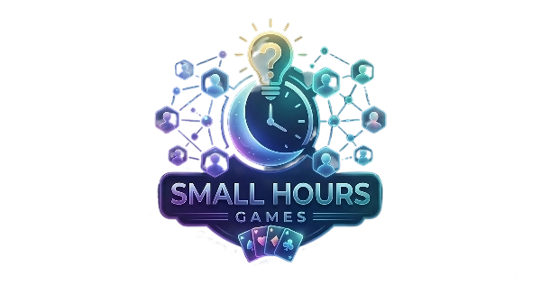

<p align="center">
  
</p>

# Small Hours Games

**One TV. A few phones. “Just one more round.”**

Turn your living room into a game night. Small Hours is a real-time multiplayer party game platform: the big screen runs the show, and everyone plays from their phone. No accounts, no phone app, no hunting for the missing controller.

Bring your friends. Bring questionable trivia confidence. Stay for the music round.

## Get the party started

1. Open Small Hours in a browser and create a room.
2. Open `/tv` on your shared screen, or `/host/CODE` to display an existing room.
3. Join from your phones using the four-character room code or the QR code on the TV.
4. Pick a nickname, vote for an activity, and let the room admin start the game.

The TV shows the questions, reveals, live scores, and party chat. Your phone holds your answers and game controls. Player avatars follow the action, so you can spot who picked *that* answer.

## Pick your next obsession

These games are available in the dashboard:

| Game | Players | What you're getting into |
| --- | --- | --- |
| 🎯 **Quiz** | 1–20 | Vote for a category, race the timer, and defend your trivia reputation. |
| 🎵 **Music Quiz** | 1–20 | Hear the clip. Name the artist or song. Try not to sing the answer out loud. |
| 🃏 **Shithead** | 2–6 | Empty your cards and avoid being the last player standing. |
| ♠️ **Gin Rummy** | 2–4 | Build your hand, watch the discards, and pick your moment. |

Music Quiz mixes genres and decades, rotates songs, and builds believable alternatives from the same playlist. Each quiz starts with a five-second countdown; music clips fade in for one second and out over the final two seconds of the question.

The engine also includes Number Guess, Spy, Högt/Lågt, Sjuan, Uno, Yatzy, Labyrint, SkogAI, a question-form tool, and a starter template. Dashboard availability is controlled separately in [`public/js/games.js`](public/js/games.js).

## Small touches, better game nights

- **Vote together.** Players choose the next activity and trivia category from their phones.
- **See the reveal.** Quiz answers show who guessed what, with player names and avatars.
- **Keep the banter going.** Party chat appears on phones and the TV.
- **Accidental refresh?** Rejoin as the same player within the 30-second disconnect grace period, using the same browser with local storage available.
- **Questions that rotate.** Unseen questions and songs come first; older picks return when the available pool runs out. History lasts for the room session.
- **A proper TV option.** The [Android TV app](android-tv/README.md) opens the host display fullscreen and keeps the screen awake.

## Run your own game night

### With Node.js

Requires **Node.js 22+** and npm.

```bash
git clone https://github.com/small-hours-games/small-hours.git
cd small-hours
npm install
npm start
```

Open **http://localhost:3001**. On phones and the TV, use the server computer's local network address, for example `http://192.168.1.50:3001`. Devices must be able to reach the server; `localhost` on a phone points to the phone itself.

Internet access is needed for external trivia, music, and CDN-hosted frontend assets.

### With Docker Compose

Build and run the checked-out source:

```bash
docker compose build
docker compose up -d
```

The Compose setup uses host networking and is intended for a Linux host. Runtime data is mounted in `./data`.

To update a source deployment after changing the code, rebuild and restart with the same commands. Check the server with:

```bash
curl http://localhost:3001/health
```

For published images, [`update.sh`](update.sh) pulls the configured GHCR image, seeds questions, and restarts the service. Pass a released tag to deploy or roll back to that version:

```bash
./update.sh              # IMAGE_TAG from .env, or latest
./update.sh 2.1.0        # example: requires this image tag to exist
```

### Optional settings

Copy `.env.example` to `.env` if you want to customize the server. Core play does not require an API key.

| Variable | Purpose |
| --- | --- |
| `PORT` | HTTP and WebSocket port; defaults to `3001`. |
| `DOMAIN` | Domain used in room notification links. |
| `GEMINI_API_KEY` | Optional generated speech. Replace the example placeholder to enable it. |
| `DISCORD_WEBHOOK_URL` | Optional notification when a room is created. |
| `IMAGE_TAG` | Published Docker image tag; defaults to `latest`. |

Trivia comes from OpenTrivia DB and is cached on disk. Music Quiz uses Deezer playlists and playable previews; availability depends on the upstream service.

## Under the hood

JavaScript, end to end. **Node.js + Express + WebSockets** on the server; vanilla HTML, CSS, and browser JavaScript on the screens. No frontend build step.

The engine is a pure function:

```text
(state, action) → { newState, events }
```

Three layers keep the responsibilities clear:

| Layer | Responsibility |
| --- | --- |
| `src/transport/` | HTTP routes, WebSocket messages, rate limiting, and broadcasting. |
| `src/session/` | Rooms, players, lobby votes, and game lifecycle. |
| `src/engine/` | Game rules, actions, scoring, and private player views. |

Game timers arrive as synthetic actions from the session/transport side. The engine doesn't need to know whether a player is holding a phone or looking at a TV.

Useful places to start:

- [`public/`](public/) — landing page, phone controller, TV display, and shared assets.
- [`src/engine/games/`](src/engine/games/) — game definitions, including the minimal [`template.js`](src/engine/games/template.js).
- [`src/fetcher/`](src/fetcher/) — trivia, music, caching, and speech fetching.
- [`tests/`](tests/) — engine, session, transport, integration, and frontend tests.
- [`android-tv/`](android-tv/) — Android TV app source and build instructions.
- [`AGENTS.md`](AGENTS.md) — repository conventions and development guidance.

## Build the next round

```bash
npm run dev              # restart the server when source files change
npm test                 # run the full Vitest suite
npm run test:watch        # rerun tests while working
npx vitest run tests/engine/quiz.test.js
```

To add a game, start with `src/engine/games/template.js`. Define `setup`, `actions`, `view`, and `endIf`, register it in `src/session/room.js`, and export it from `src/engine/games/index.js`. Add phone and TV renderers, tests, and a dashboard entry when it's ready to play.

Keep rules in the engine, secrets out of player views, and the next round easy to start.

---

*Party games best played in the small hours.*
